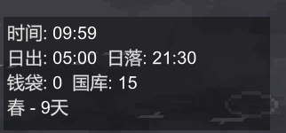

**配置完成后首次进入游戏可能花费较长时间，请耐心等待** 
**Ciallo～ (∠・ω< )⌒★** 
**缩放建议4×，观感最佳**

1. 安装配置教程 

     

    1. 点开绿色按钮，点击菜单下面的Download ZIP下载这个项目的压缩包

     

    2. 通过上图所示方式可打开游戏本地文件s

     

    3. 打开后正常原生游戏文件应该如上图所示 ( 如有不同请及时告知，本人也不记得原生文件有哪些了 ) 

    4. 将下载后的压缩包解压，将BetterKingdom文件夹中的内容全部复制到上面的游戏文件夹中 

     

    5. 完成后如上图所示，之后直接开始游戏即可 

2. mod内容 

     

    1. 在游戏界面上方添加了全局地图，地图中包含： 
        - 港口传送门及洞窟(红色方块)
        - 最靠近洞窟的两个城墙及两个箭塔(蓝色和绿色方块) 
        (为了方便判断当前岛是否适合久居)
        - 玩家(浅蓝色方块)
        - 主城(白色方块)
        - 怪物(紫色细线) 
        (只显示每一批次中最靠近城墙的那一只)
    2. 在地图下方左侧显示职业统计与火油桶统计 
   **将光标放在地图中的点上可以查看该点名称**

     

    4. 左下角显示：
        - 当前的游戏时间
        - 日出日落时间(固定)
        - 当前钱袋中与国库中的金币数量
        - 当前季节以及当前处于该季节的第多少天(一个季节16天，蓝月为第16天)
