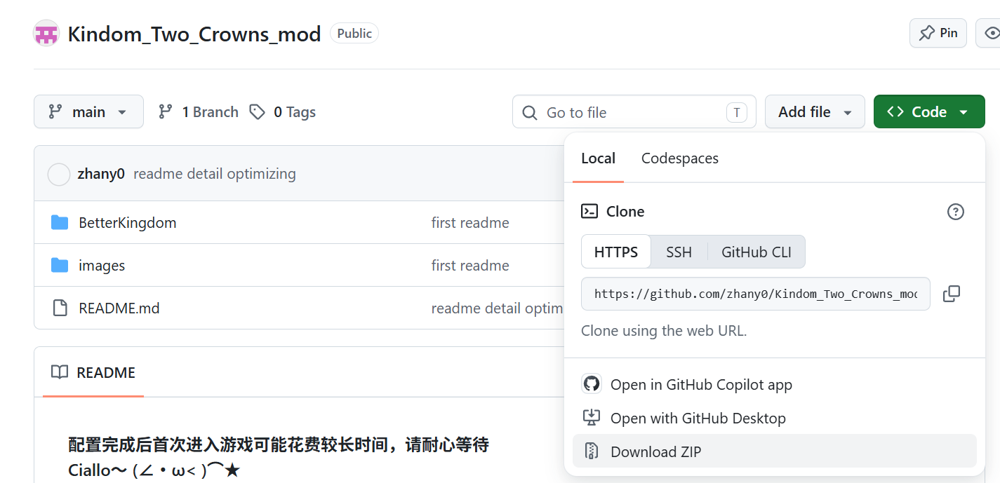
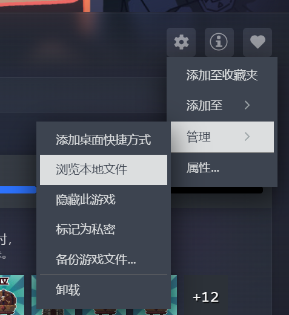
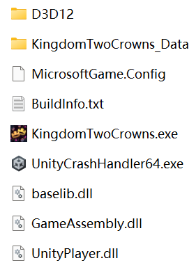
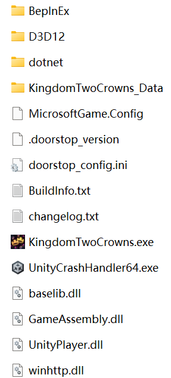
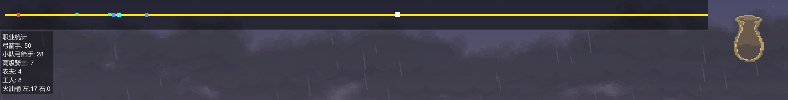
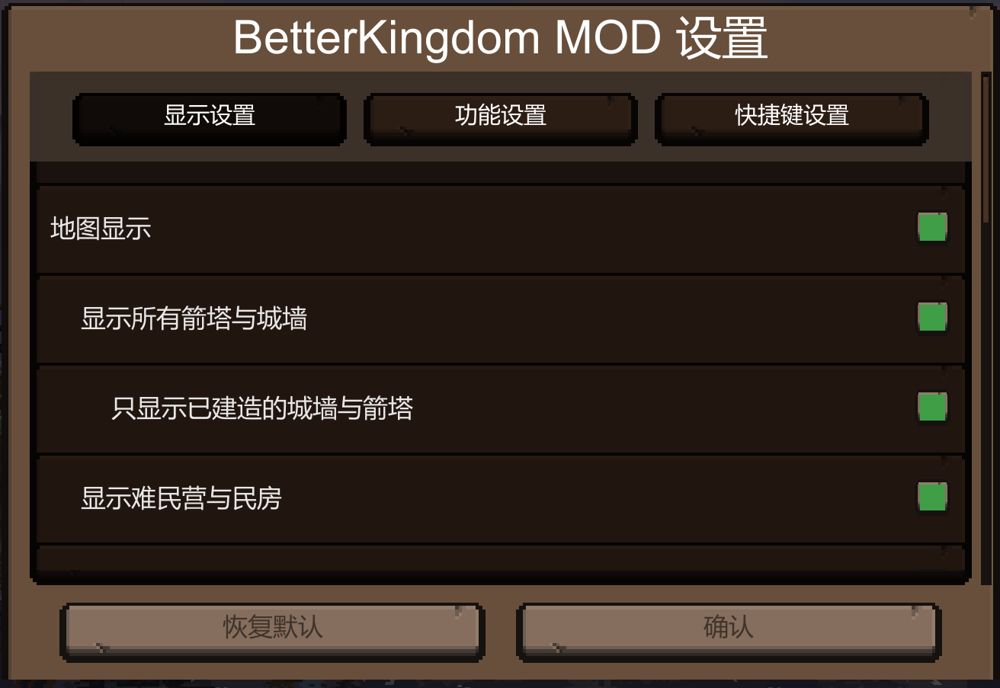

注意事项：
- **配置完成后首次进入游戏可能花费较长时间，请耐心等待**
- **Ciallo～ (∠・ω< )⌒★**
- **缩放建议4×，观感最佳**
- **不要忘记在面板中打开额外功能喔**
- **下图中右上角的commits可以查看更新日志=￣ω￣=**

安装配置步骤
1. 点开绿色按钮，点击菜单下面的Download ZIP下载这个项目的压缩包

2. 通过下图所示方式可打开游戏本地文件

3. 打开后正常原生游戏文件如下图所示

4. 将下载后的压缩包解压，将BetterKingdom文件夹中的内容全部复制到上面的游戏文件夹中

5. 完成后如下图所示，之后直接开始游戏即可

mod内容
1. 在游戏界面上方添加了全局地图，默认包含(不可关闭)：
    - 港口传送门及洞窟(红色方块)
    - 玩家(浅蓝色方块)
    - 主城(白色方块)

    可选显示：
    - 地图
    - 箭塔与城墙建造位
    - 已建成的箭塔与城墙
    - 难民营与民房
    - 雕像
    - 坐骑出生点
    - 未开启的宝箱
    - 科技解锁点
    - 怪物(只显示每批次、每个方向距离城墙最近的那一只)
    - 职业统计与火油桶统计
    - 金币数量统计
    - 时间与季节、季节日
    - 怪物血条
    - 农作物生长进度条

    可选功能：
    - 钱袋与国库共通(若钱袋已满，捡入的多余金币将自动存入国库；若钱袋为空，可长按支付键(默认为"S")从国库中取钱填满钱袋)

    **将光标放在地图中的点上可以查看该点名称**

2. mod设置界面:
    - 可以更改地图中元素的可视状态
    - 可以更改快捷键/键位

    **默认使用F3+F4打开，可以修改**

3. 修复了弓箭手莫名其妙卡在墙中的bug

4. 若灯塔方向传送门被摧毁，则只会留下两个工人而不是四个

**有关季节日的bug修复由衷感谢@初柔雪(bilibili)的帮助**